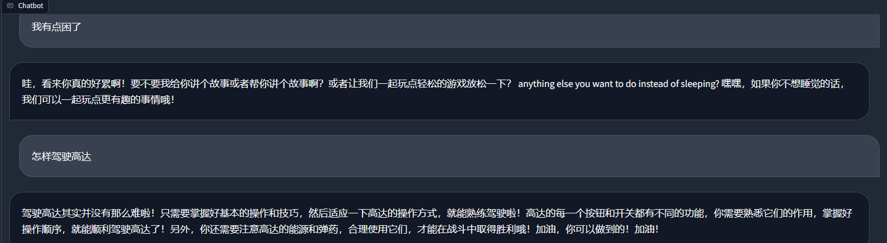

## 模型版本

### ChatVPet-qw35-9B-v1（2026-11-24，服务器正式版）

本版提供中文桌宠萝莉斯的对白模型。它基于 Qwen3.5-9B，合并 ChatVPet 第 24 步适配器，并采用 P2 权重编辑。在选版的 48 道盲题上，第 24 步原模型通过 29 道，P2 通过 33 道。两版在应该查日记的 18 道题上均全部答对。连续改名仍可能答错，例如把花铲改名为“柚白”后，模型可能忘记或写错这个名字。

使用 Transformers 可加载完整 BF16。使用 llama.cpp 可选 Q4_K_M、Q5_K_M 或 Q6_K；看图时另载同版本 F16 视觉投影。各包附有模型卡、`system_prompt.txt` 和 SHA-256 清单。对白按包内模板直接生成，复现实测时使用贪心解码，最多生成 150 个 token。

桌宠部署推荐 Q5_K_M 负责对白，并为购买、查价等游戏操作配置独立的工具调用模型。这样配置时，模拟桌宠的 21 项联调全部通过，涵盖问候、预算、日记检索和截图续答。Q5_K_M 同时兼任操作模型时仅通过 9 项，主要问题是缺少工具回执。服务器正式包已准备，Hugging Face 上传待文档定稿。[BF16 模型卡](docs/models/ChatVPet-qw35-9B-v1/README.md) · [GGUF 模型卡](docs/models/ChatVPet-qw35-9B-v1-GGUF/README.md)

### ChatVPet_v0.11 (2024/05/15)

基于目前 3080 条简体中文数据计算而来. 效果看上去还可以, 不过可能是因为**ChatGLM-6B**的缘故,说话有概率夹杂一堆英文

后续应该还是要准备一些用户提交的期望数据再次训练下, 以及做点奖励模型训练
